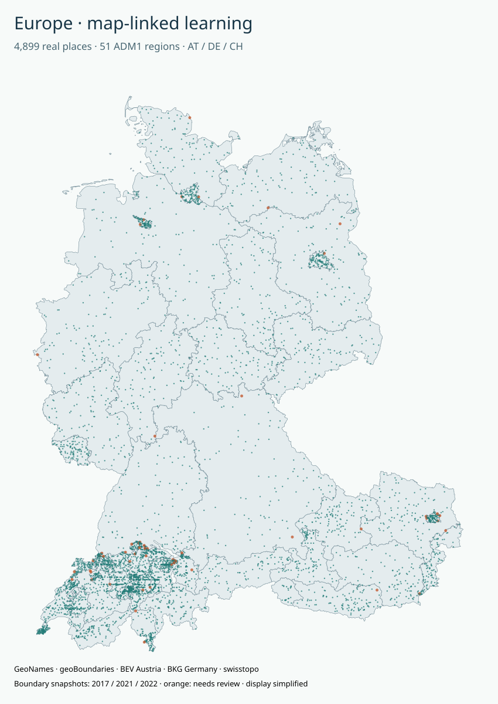

# 実地図と連携する欧州地名の学習実験

**2026-10-01: 小型判定モデルの強化学習を実行済み。**
実在する4,899地点の座標を、オーストリア・ドイツ・スイスの51行政区画の
実際の境界ポリゴンに照合しました。出典・境界が一致するかを学ぶ最初の実験です。
企業データは含みません。

[地図をダウンロードして開く](map.html)と、地点ごとの台帳・地図・モデル判定を比較できます。
HTMLは単体で動作します。外部タイルやスクリプトを自動取得しません。
地点からOpenStreetMapの現在の周辺図を開くリンクも付けています。
GitHub上ではHTMLはソース表示になります。Rawファイルを保存してブラウザで開いてください。



## 何を学習したか

地図による点と行政区画の包含判定、台帳の所属、提示された所属、境界までの距離、
仮定した座標の不確かさを入力として、次の行動を選ぶ小型MLPを学習しました。

| 行動 | この実験での意味 |
|---|---|
| MATCH | 地図と台帳が一致し、提示された所属も一致する |
| CONFLICT | 地図と台帳は一致するが、提示された所属が違う |
| REVIEW | 出典間の不一致、境界付近、地図の該当なし・複数などで保留が必要 |

これは**一段階の強化学習（contextual bandit）**です。
政策から行動をサンプリングし、正解 +1、誤った保留 -0.25、誤った断定 -2 の報酬で
REINFORCEを実行しました。ラベルを使う教師あり損失による更新ではありません。
7特徴量 → tanh 24ユニット → 3行動、各2,500ステップ・3乱数条件のCPU実行です。
地名・地点ID・国・座標そのものはモデルの特徴量に含めず、座標から計算した地図照合結果を渡します。
学習モデルの重みは[policy.json](results/policy.json)に保存しています。

**LLMの追加学習や、この会話のAI自体の更新ではありません。**
Hugging Faceでの成果保存が認証・権限エラーとなったため、クラウド学習ジョブは投入していません。
今回完成したものは地図検証を利用する小型判定モデルと、そのデータ・評価・再現コードです。

## 実行結果

| 区分 | 地点数 | 問題数 | 0.25度区画数 |
|---|---:|---:|---:|
| 学習 | 3,711 | 11,131 | 595 |
| 検証・モデル選択 | 764 | 2,292 | 129 |
| 固定評価 | 424 | 1,270 | 106 |

同一地点・同一区画の学習／検証／評価間の重複はありません。
3条件とも評価1,270問中1,268問が正解（**99.84%**）、macro-F1は0.99844でした。
選択したseed 17の未学習モデルの正解率は32.83%でした。
選択は検証データの平均報酬・macro-F1だけを使い、評価データを使った再調整はしていません。

ただし、**この値は作成した照合ルールを再現する精度です。住所の正確さや汎用地理能力の評価ではありません。**
正解を定義する幾何ルール自体は当然100%です。モデルが幾何判定より優れるという結果ではありません。
地図照合前提の実験なので、名前だけから座標を推定するジオコーダーにもなっていません。

### 実際に起きた誤り

`gn:3333508` Schöpfleithnersiedlungでは、台帳は`AT-9`、2017年の境界では`AT-3`でした。
その元の所属提示と、人工的に変更した所属提示の2問で、モデルは必要な`REVIEW`を`CONFLICT`と誤判定しました。
異なる年の出典のどちらが正しいかは、この実験だけでは断定できません。

`predict.py`は必ず地図・台帳の確認を先に適用し、不一致は`REVIEW`にします。
生のモデル判定・幾何ルール・確認後の判定を分けて返します。
モデル確率は較正していません。台帳の原データは変更しません。

詳しい数値は[metrics.json](results/metrics.json)、学習過程は[training-history.json](results/training-history.json)、
評価全件は[test-predictions.jsonl.gz](results/test-predictions.jsonl.gz)を参照してください。

## 実データと人工問題の区別

| 項目 | 由来 |
|---|---|
| 地名・座標・台帳の所属 | GeoNames 2026-09-29取得分の現在地名候補 |
| 行政境界 | geoBoundaries経由の実際のADM1ポリゴン |
| 誤った所属の提示 | 同国内の別ADM1を意図的に選んだ人工問題 |
| 座標の不確かさ | 通常100m、境界を越える問題では境界距離+250mという人工的な仮定 |
| 要確認の正解 | 出典不一致・複数境界・該当なし・仮定した不確かさと境界距離の関係から計算 |

元の所属提示の照合では4,846地点が一致、53地点が要確認でした。
標本はADM1ごとに最大100地点（所属未確定の別枠を含む）のSHA256順抽出です。
人口や全地名の分布を代表する標本ではありません。

| 国 | 抽出地点 | ADM1 | 境界が表す年 | 境界の原出典 |
|---|---:|---:|---|---|
| AT | 901 | 9 | 2017 | Federal Office for Metrology and Survey, Austria / geoBoundaries |
| DE | 1,600 | 16 | 2021 | Federal Agency for Cartography and Geodesy |
| CH | 2,398 | 26 | 2022 | Federal Office of Topography swisstopo |

**現在の法定境界を確認したデータではありません。**
3か国のADM1だけを扱い、57か国全部、町区・街路・建物・郵便番号・配達可能性は未学習です。
行政区画は学習と評価で共通で、隣接する区画が近接する場合もあります。
未知の国・行政区画への汎化を測っていません。
距離はEPSG:3035投影で計算した近似値で、測量精度や境界形状の誤差は評価していません。

## 再実行

Python 3.12で確認しました。リポジトリの`europe-registry/`が必要です。

```bash
cd europe-map-learning
python -m venv .venv
. .venv/bin/activate
pip install -r requirements.txt
python prepare.py --cache .cache --per-region 100
OPENBLAS_NUM_THREADS=1 python train.py --steps 2500
python -m unittest -v test_learning.py
python visualize.py
python predict.py --id gn:3333508 --radius 100
```

`prepare.py`は[sources.json](sources.json)に固定した約32MBの原解像度境界を取得し、
SHA256を確認して使用します。台帳のメタデータ・分割CSVのSHA256も照合します。
ADM1の照合方法は[adm1_crosswalk.csv](data/adm1_crosswalk.csv)に記録しています。
AT/DEは一意の正規化名称・別名照合、CHは州コードの対応で、全51区域の一意性を検証しました。
名称の類似度で未確認の候補を自動統合しません。

地図表示の境界は300mで簡略化しています。個別区域の簡略化によって表示上の隙間が出る場合があります。
**学習ラベルは原解像度から計算し、表示用の形状を使いません。**
ライセンスは出典別に異なります。[NOTICE.md](NOTICE.md)を保持してください。
